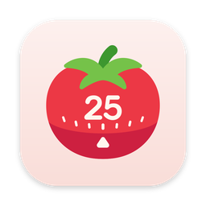
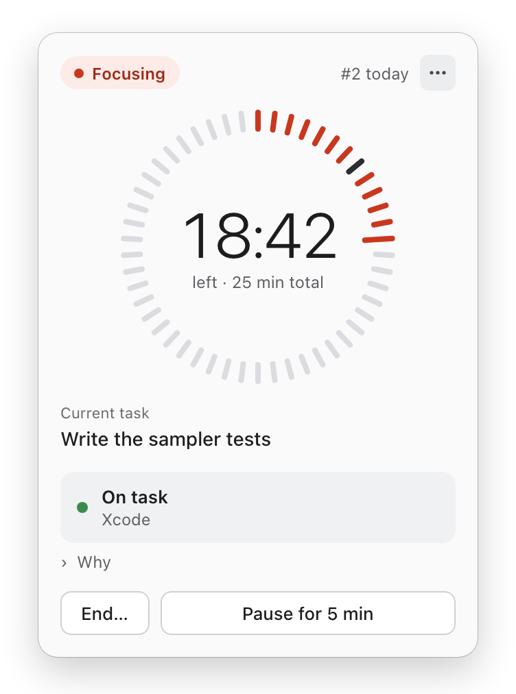
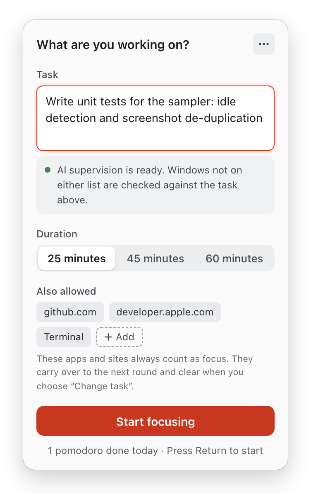
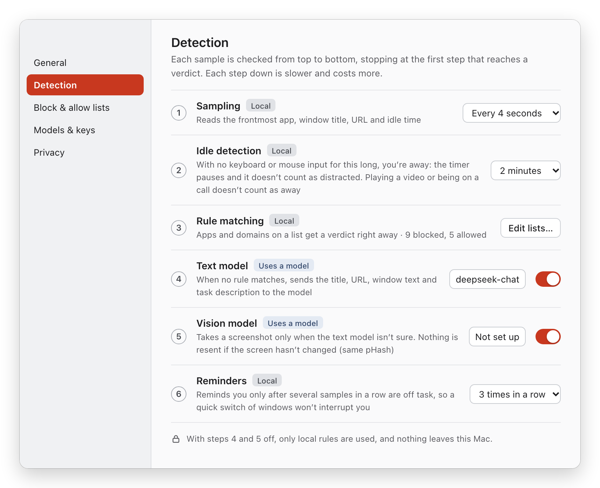

<div align="center">



# PomoSupervisor

**The pomodoro timer that keeps an eye on you.**

A macOS menu-bar timer that checks what you're actually working on and nudges you when you drift.

macOS 12+ · English / 简体中文 / 繁體中文 / 日本語 · [MIT](LICENSE)

<br>





</div>

## Highlights

- **Task-aware focus.** Set what the round is for and go. Quick lookups don't trigger reminders—only repeated off-task samples do.
- **Away vs. distracted.** No keyboard or mouse input pauses the timer instead of counting as distraction (active video or calls stay awake).
- **Works with or without AI.** Block/allow rules handle known apps and sites locally; an optional model judges everything else against your task.
- **One-click corrections.** Mark a false alarm as "This is part of the task" (or "Actually working" in Focus Review) to allow it going forward.

## How it decides

Each sample walks down a chain and stops at the first clear answer ([original sketch](docs/decision-chain.svg)):



1. **Sample** — Reads the frontmost app, window title, browser URL, and input idle time.
2. **Idle check** — Pauses if you're away (unless a video or call keeps the display awake).
3. **Rules** — Matches local block and allow lists (apps, domains, title keywords).
4. **Text model** *(optional)* — Sends title, URL, task, and a snippet of window text; concludes only when confident.
5. **Vision model** *(optional, off by default)* — Sends a screenshot only when the text model is unsure and the screen has changed.
6. **Smoother** — Triggers a reminder only after N distracted samples in a row.

## Focus Review


After each round, Focus Review breaks down time focused, distracted, and away on a timeline, showing which stage judged each distraction.

## Privacy

- Sampling, idle detection, and rule matching run locally. With models off, nothing leaves your Mac.
- With a model enabled, only the window title, URL, task, up to ~800 chars of window text (password fields are skipped), and—if vision is on—a screenshot are sent to your chosen provider (including local Ollama). Nothing is stored remotely.
- API keys live in the macOS Keychain (`PomoSupervisor`); settings and stats are in `~/Library/Application Support/dev.aoba.pomosupervisor/`.

## Install

Build from source (requires macOS 12+, Rust 1.97.1+, Node 22.12+, pnpm, and Xcode Command Line Tools; or `nix develop` via `flake.nix`):

```sh
pnpm install
pnpm tauri build      # outputs .app and .dmg to src-tauri/target/release/bundle/
```

**Models (optional):** Open **Settings → Models & keys**, pick a preset (OpenAI-compatible, Anthropic, Ollama, or decision-model endpoints), paste your key, and test the connection.

### Permissions

| Permission | Purpose | If denied |
| --- | --- | --- |
| **Screen Recording** | Window titles and screenshots | Only app names are checked |
| **Automation** | Current tab URL in Safari, Chrome, Arc, Edge, Brave | No URL from those browsers |
| **Accessibility** | Window text for models; URLs in browsers like Firefox | Models see title and URL only (toggle in Privacy) |

## Development & License

See [docs/development.md](docs/development.md) for dev commands, UI preview URLs, and code layout.

Licensed under [MIT](LICENSE).
