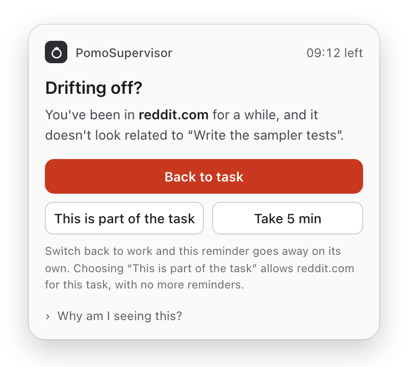
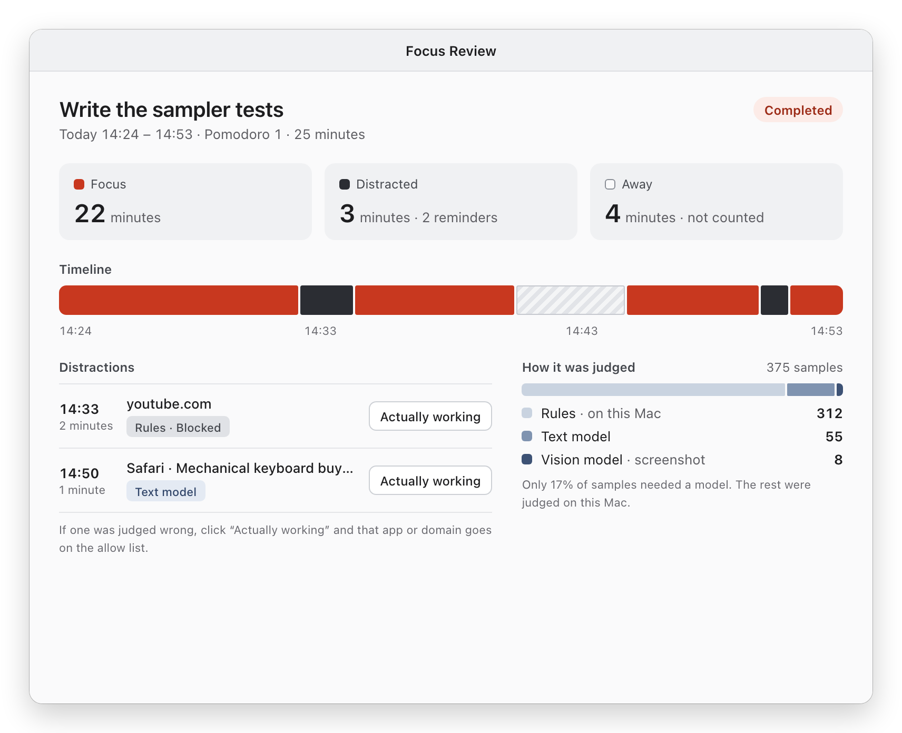
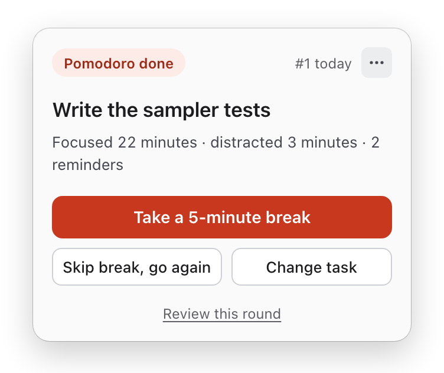

<div align="center">


# PomoSupervisor

**The pomodoro timer that keeps an eye on you.**

While you focus, it glances at the window in front of you every few seconds, and taps you on the shoulder from the menu bar when you drift.

macOS 12+ · English / 简体中文 / 繁體中文 / 日本語 · [MIT](LICENSE)

<br>





</div>

## Why

An ordinary pomodoro timer only counts down. Spend twenty minutes on videos and it still hands you a pomodoro. PomoSupervisor knows what this round is for, and it can see what you are actually doing.

- **Write the task and go.** It lives in the menu bar: click, say what this round is for, press Return.
- **It speaks up only when you've drifted.** A reminder takes several off-task samples in a row, so switching windows to look something up doesn't set it off. Go back to the task and the reminder clears itself; stay away and it comes back after 1, 2 and 5 minutes.
- **It tells drifting from stepping away.** No keyboard or mouse input means you're away: the timer pauses and nothing counts as distraction. A lecture video or a call that keeps the screen awake doesn't count as away.
- **One click corrects a wrong call.** "This is part of the task" allows that app or site, and the next round keeps it.
- **Every round is accounted for.** How long you focused, where you drifted and how long you were away, on one timeline.
- **It works without a model.** Block and allow lists are enough to run it. Add a model and windows on neither list are judged against your task.

## How it decides

Each sample goes down the chain and stops at the first step that reaches a verdict. The first three steps run on your Mac, cost nothing and need no network; only windows the rules can't settle are put to a model.


1. **Sampling.** The frontmost app, its window title, the browser's URL, and how long the keyboard and mouse have been idle.
2. **Idle detection.** Idle past the threshold means away: the timer pauses and nothing counts as distraction. A video or a call that keeps the display awake doesn't count as away (keep-awake tools such as `caffeinate` and Amphetamine don't qualify).
3. **Rule matching.** Block and allow lists of apps, domains and title keywords. A match settles it.
4. **Text model.** The title, the URL, some of the window's text and your task go to the model, which only concludes when it is confident.
5. **Vision model.** A screenshot, taken only when the text model isn't sure, and not sent again while the screen looks the same (same pHash). Off by default.
6. **Reminders.** Only N distracted samples in a row bring up the reminder, play the sound and go into the statistics.

The original design sketch (in Chinese) is in [docs/decision-chain.svg](docs/decision-chain.svg).

## After a round



Focus Review lays the round out: the timeline, what each distraction was, and which step called it. Click "Actually working" on one that was judged wrong and that app or domain goes on the allow list.

## The rules beyond the clock



- **It doesn't go quiet when time is up.** When a pomodoro or a break ends and nobody answers, the card stays in front of you for a full 30 seconds before it puts itself away (and waits for you if you aren't there), and the menu bar starts counting up as `+mm:ss`. An overrun break is chased again at 2 and at 5 minutes; a finished pomodoro gets one reminder at 5 minutes that the break is still owed. A reminder that came due while you were away fires at your first input back. Only when you've seen them all and 15 minutes have passed does it let the round go.
- **Every pause has a limit.** A pause lasts one short break and then the round carries on by itself. You can ask for more minutes, up to 30 in total.
- **Ending early comes in two kinds.** "Task's done" keeps the time and earns the break, and counts as a pomodoro once half the round was worked. Only "Give up this round" counts for nothing.
- **It tells you what happened while you were gone.** How long the timer stood still, and whether it is running again. If you were reading the whole time, click "I was here": the time is given back and the idle threshold is tripled for the rest of the round. With "Resume when you're back" off, the round waits for you to continue: it asks again at 2 and at 5 minutes, and ends as given up after 15.
- **Allowing has a scope.** "This is part of the task" allows the app or site for this task; for a site on the block list, only the current page. What you've allowed is also written into the task description the model sees. "Change task" clears it.
- **You can see it coming.** When the window in front is judged off task, a ⚠ appears after the time in the menu bar before any reminder. It goes when you return to the task or switch windows.

<br clear="right">

## Privacy

- Sampling, idle detection and rule matching all happen on your Mac. With the text and vision models off, nothing leaves it.
- With a model on, what is sent is the window title, the URL, your task, and up to about 800 characters of the window's text (password fields are never read; nothing is saved). The vision model also receives a screenshot. You choose where it goes; with a local Ollama it never leaves the machine.
- API keys are kept in the macOS keychain (service `PomoSupervisor`). Settings and statistics are in `~/Library/Application Support/dev.aoba.pomosupervisor/`.

## Install

There are no prebuilt releases yet, so build it from source. You need macOS 12+, Rust 1.97.1+, Node 22.12+, pnpm and the Xcode Command Line Tools.

```sh
pnpm install
pnpm tauri build      # the .app and .dmg land under src-tauri/target/release/bundle/
```

With Nix the toolchain is in `flake.nix`: `nix develop -c pnpm tauri build`.

### Permissions

| Permission | What it is for | Without it |
| --- | --- | --- |
| Screen Recording | Reading other apps' window titles; screenshots | Only the app's name can be judged |
| Automation | Reading the current tab's URL from Safari, Chrome, Arc, Edge and Brave. Each browser asks once | No URL for that browser: only the app's name and the title are judged |
| Accessibility | When no rule matches, reading the focused control and some of the frontmost window's text for the model; also the URL in browsers AppleScript can't ask, such as Firefox | The model sees only the title and the URL. On by default; turn it off in Settings → Privacy |

## Setting up a model

In Settings → Models & keys, pick a preset, paste an API key and click "Test connection". It works without one, but windows on neither list are then left alone.

| Provider | Base URL |
| --- | --- |
| OpenAI-compatible | Empty for OpenAI itself; other services need the `/v1`, e.g. `https://api.deepseek.com/v1` |
| Anthropic | Empty for the official API |
| Ollama | Empty for `http://localhost:11434` |
| Decision model (System One-compatible) | The **full endpoint**. Empty is TypeSafe, `https://api.typesafe.ai/v1/systemone`; OpenRouter is `https://openrouter.ai/api/alpha/decisions`; AIMLAPI is `https://api.aimlapi.com/v1/decisions` |
| Decision model (OpenAI) | Empty for `https://api.openai.com/v1/decisions` (model `gpt-6-luna`) |

A decision model writes no text: it returns the probability of each of the two options, focused and distracted. It is fast and billed on input only. Below the confidence threshold its answer is treated as unsure.

As a vision model it has to accept images: TypeSafe's jev-1.14, the image-capable decision models on OpenRouter, AIMLAPI's jev-1.14 and liquid/d1, and OpenAI's gpt-6-luna do; Telnyx and Eden AI are text-only for now. "Test connection" on the vision slot sends a small image, so a setup that can't take one shows up early.

## Languages

The interface, notifications, menu bar, verdict reasons and the prompts sent to the model all follow the system language: English (US), English (Australia), 简体中文, 繁體中文 and 日本語, with English for anything else. The language is read at launch, so restart the app after changing it. The default block and allow lists on first launch follow the language too (Japanese adds nicovideo.jp, Traditional Chinese adds dcard.tw).

## Development

```sh
pnpm tauri dev        # run it
pnpm check            # before committing: lint, typecheck, build, clippy, tests
```

The code layout, the UI previews and what differs in a debug build are in [docs/development.md](docs/development.md).

## License

[MIT](LICENSE)
